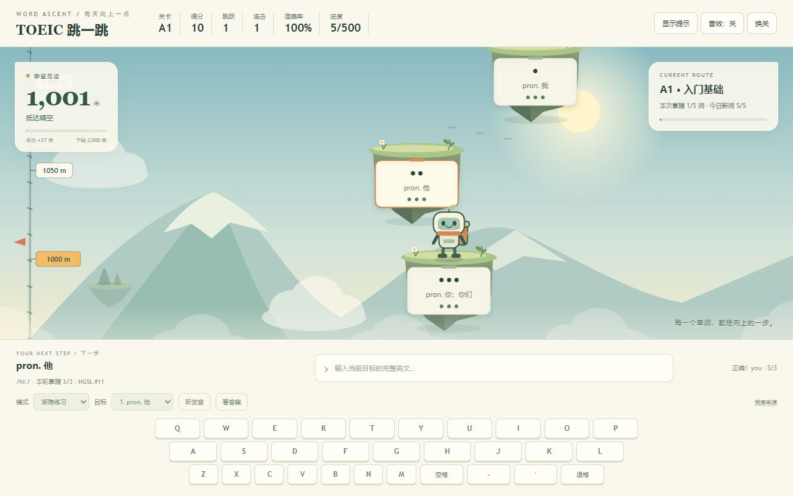
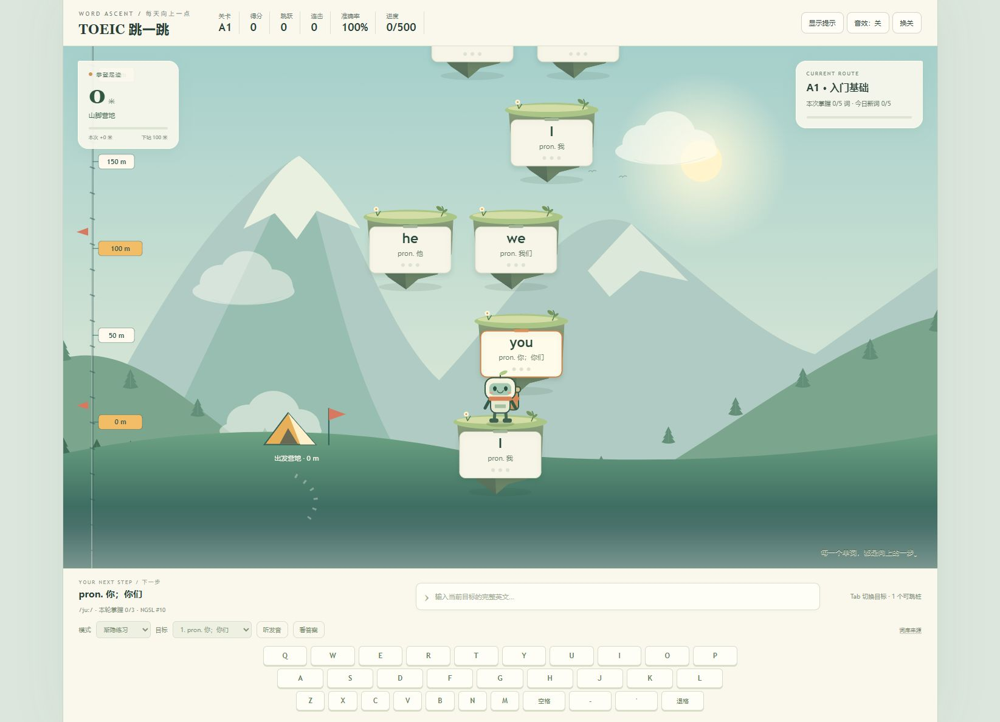
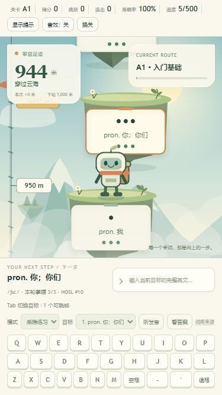
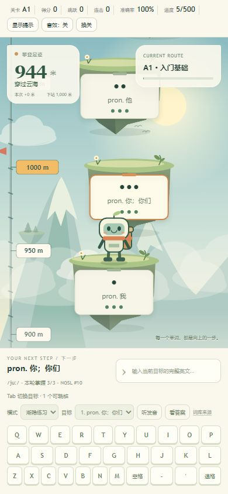
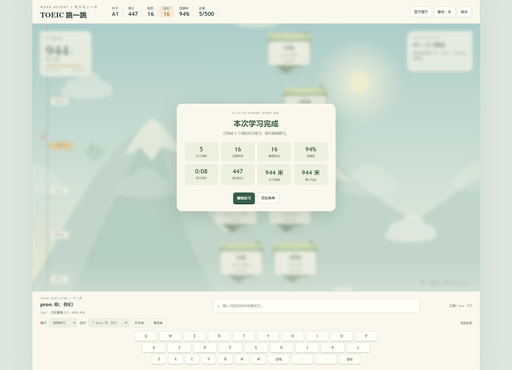
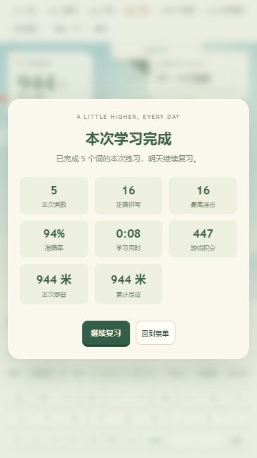

# 绘本美术版质检

后续独立质检发现与修复见 [RECHECK_QA.md](RECHECK_QA.md)。本文件为美术版初次验收记录。

日期：2026-10-19。对象：重新生成的 `托业英语跳一跳.html`，以及 index.html / ascent.js / app.js 源文件。

## 技能与设计

已使用 skill-installer 检索官方 curated 目录，选用已有 ui-design 和 web-development 指导设计及验证，没有安装无关的 Figma/托管技能。

设计落地为自然绘本风：雾青天空、雪峰森林、暖纸词牌、覆草岩石浮岛、背包围巾机器人。配色和字体统一，词牌保持清晰不透明底，固定绳尺与营地继续提供攀登参照。美术使用 Canvas / 内联 SVG，无新增网络素材或运行依赖。

## 功能验证

- `node tools/test.js`：原有11组学习、三次掌握、复习、存档、攀登和缩放检查全部通过。
- JavaScript 语法及离线文件内嵌脚本语法检查通过；离线文件有4段内嵌脚本，没有外部 script src。
- 使用独立本地测试地址，未清除已有学习存档。浏览器实际从0米出发，故意打错一次，之后16次正确拼写，五词全部达到3/3，结算累计944米、准确率94%。
- 刷新后仍显示944米、已掌握5/500；重新开始复习从944米继续，正确拼写一次后到达1001米、区域“抵达晴空”。
- 浏览器运行控制台未发现错误或警告。

## 视觉验证

| 页面/尺寸 | 检查结果 |
|---|---|
| 桌面默认窗口 | 起点有营地、雪峰与森林；爬升后营地下移退出，远山与云层分层移动；词牌、机器人和键盘清晰 |
| 桌面1280×800 | 无横向溢出；左右记录面板分离，当前目标单词不被面板遮住 |
| 手机375×667 | 页面宽375、高667，键盘底部654；左右面板间隔81px，无横向溢出 |
| 手机390×844 | 页面宽390、高844，键盘底部828；左右面板分离，无横向溢出 |
| 手机菜单 | 改为全屏覆盖，375×667下开始按钮完整可见；菜单内部没有横向滚动 |
| 桌面与手机结算 | 标题、8项统计、继续/菜单按钮可见，无内容遮挡 |

手机边界数据见 [art-layout-checks.json](art-layout-checks.json)。

## 本轮修复

1. 旧菜单长标题折行、出现横向滚动：改为独立标题与山峰徽章，重设字号和内边距。
2. 手机菜单只占场景高度，开始按钮被挤到滚动区下方：移动端采用全屏菜单/结算，按钮直接可见。
3. 窄屏海拔卡片接近浮岛上沿：缩短卡片高度，隐藏重复的细进度条但保留高度、区域、本次和下一站。
4. 浏览器模块脚本缓存造成新旧画面混用：最终验收重新生成的单文件，全部脚本内嵌。

浏览器自动化的动态文本定位曾遇到节点替换，改用稳定输入栏的 DOM 状态判断落地；没有为通过测试更改游戏逻辑。

## 最终截图

## 验证边界

本轮为本地浏览器与响应式尺寸校验，不是实体手机测试。系统语音质量依赖本机语音服务，未人工听音校验；减弱动态模式由现有代码测试覆盖。绘本画面不改变托业词汇路线和学习机制，也不代表考试能力认证。
