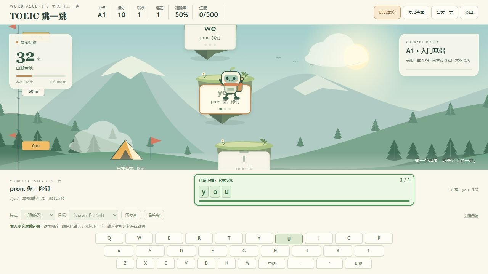
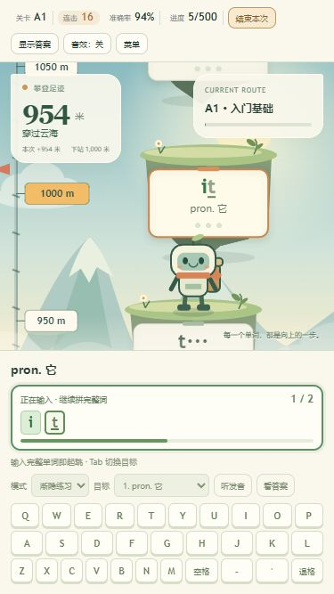
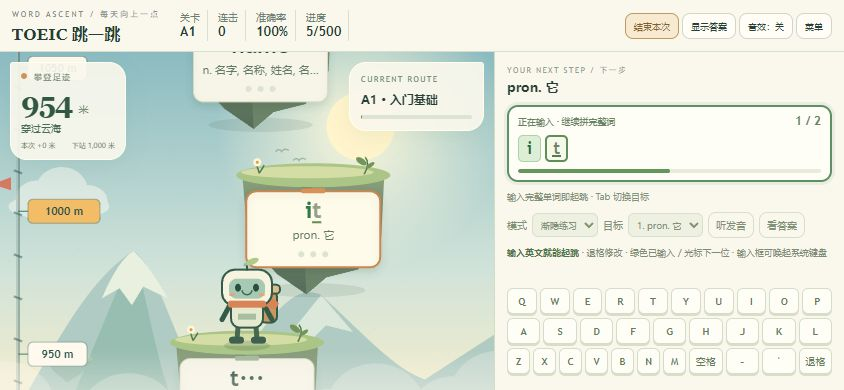

# 无限攀登与输入反馈验收

日期：2026-10-19。对象：源码及重新生成的 `托业英语跳一跳.html`。

## 交付内容

- 无限攀登放在主入口，不使用每日新词额度。每组接约5个新词并安排未完成/到期词；完成后自动接下一组，继续前进，不弹强制结算。
- 同一学习单元掌握后自动进入后续单元/等级；全词库已掌握时轮换复习。高度、分数、跳数和用时在自动换组时不重置。
- 顶栏“结束本次”主动结算；空中点击会先落地。每日计划与只复习旧词仍可选，三种入口共用本机词汇进度。
- 输入有绿字、下一位光标、字母计数、进度条、红错字和成功满格反馈，当前浮岛同步更新。错字保留已正确输入的前缀；完整单词保留到起跳结束，不再立即清空。
- 原生输入框支持键盘输入/粘贴，并保留屏幕字母键。检测到非英文输入时给出提示，不把中文输入法当成答错。输入状态有屏幕阅读器通知，减弱动态模式关闭光标动画。

## 自动验证

`node tools/test.js`：30组全部通过，覆盖原有21组与新增9组：

1. 无限模式绕过每日限额，原每日计划仍受原额度约束。
2. 自动接下一组并继续学习第6新词，主动结束可结算。
3. 自动跨单元，保留本次分数与世界高度。
4. 空中结束请求在落地后执行。
5. 字母位置/计数/进度、错误前缀保留、完整成功反馈。
6. 原生输入/粘贴与中文合成输入处理。
7. 回忆模式只显示已输入前缀，不泄露剩余答案。
8. 已掌握一个等级后继续下一等级。
9. 整个词库掌握后可继续玩，兜底复习会轮换。

脚本语法检查和离线4段脚本与当前源文件一致性另行验证。

## 浏览器实测

使用独立地址 `http://127.0.0.1:8980/托业英语跳一跳.html`，没有清除用户真实存档。

- 实体键盘输入 `y`，立即显示1/3、绿色y和下一位光标；输入z后红色z持续显示，原y保留。
- 在原生输入框输入/替换为 `yo`，显示2/3；完整 `you` 触发起跳，3/3和绿色全词保留到飞行结束。
- 第一组15次正确拼写后自动进入第2组，没有弹出结算或每日额度提示。随后输入 `they`，成功学习当天第6个新词。
- 主动结束时：练习7个词（含未完成的it），正确16次、错误1次，完成本轮掌握5词，954米。结算按钮可继续无限攀登。
- 刷新显示“今日已练新词6”、已掌握5/500、954米。每日计划只安排原未完成词；再选无限攀登继续补充新词。
- 原生输入中文文本显示“请切换英文键盘”；改回英文后恢复输入，不新增拼写错误。
- 浏览器游戏控制台未发现错误或警告。

## 响应式与视觉

| 视口 | 页面高 | 键盘底部 | 结果 |
|---|---:|---:|---|
| 320×568 | 568 | 555 | 输入区/键盘完整，无横向溢出 |
| 375×667 | 667 | 654 | 同上 |
| 390×844 | 844 | 828 | 同上 |
| 820×768 | 768 | 749 | 同上 |
| 1024×600 | 600 | 588 | 矮笔记本窗口修复后通过 |
| 844×390 | 390 | 378 | 横屏左右分栏，通过 |

320×568、375×667、1024×600、844×390的菜单无限入口均完整可见，内容无横向滚动。数据见 [endless-layouts.json](endless-layouts.json)、[endless-menus.json](endless-menus.json)。

## 实际截图

## 范围和限制

- 当前为离线静态游戏，每位玩家存档在自己的浏览器；没有账号、跨设备同步、联网排行榜、实时多人或公开托管。没有做上线并发验收，不能宣称已经上线供大量用户访问。
- 浏览器不允许读取Chrome file页面，因此没有直接检查/改动用户当前运行状态；采用原有本机HTTP开发预览流程验证同一份交付代码，未绕过file协议访问限制。
- 手机尺寸为浏览器模拟，未用实体手机检查系统键盘占屏；中文合成路径由自动测试覆盖，浏览器实测非英文文本提示。系统发音质量未人工听音验证。
- 原8772端口属于 Windows 保留的8771–8870范围，只读确认后改用8980，未更改系统网络设置。
