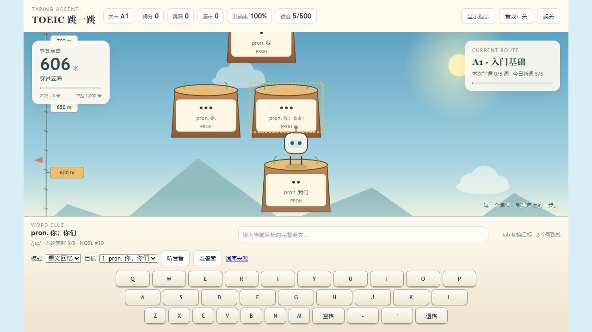
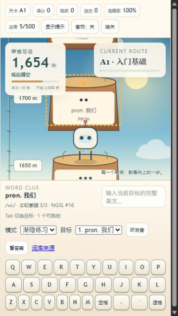
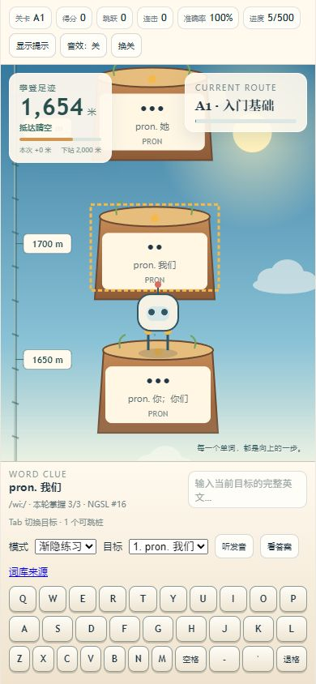

# 攀升视觉更新质检

后续绘本美术版的最新检查见 [ART_QA.md](ART_QA.md)。本文件保留上一版攀升功能的质检记录与旧截图。

日期：2026-10-19。检查对象：源码页面与重新生成的 `托业英语跳一跳.html`。

## 结果

- `node tools/test.js`：11 组检查全部通过。
- `node --check app.js`、`node --check ascent.js`：通过。
- 浏览器实际输入，连续从 0 米到 1246 米；继续复习达到 1654 米。跨轮从上次高度继续。
- 刷新后分别验证恢复 606 米、1246 米；词汇掌握进度保留。
- 浏览器控制台检查：未发现运行错误或警告。
- 在真实浏览器中查看并保存了起点、云层、高空、结算以及两种手机尺寸截图。

## 视觉检查

| 场景 | 检查内容 | 结果 |
|---|---|---|
| 山脚起点 | 营地、山脊、零米旗与角色位置相互对应 | 通过 |
| 连续攀登 | 固定绳结、刻度与地貌随着镜头向下移动，背景不靠上下循环制造位移 | 通过 |
| 云层与高空 | 营地离开画面，山脊逐渐退出，天空颜色变化，高空仍保留绳尺 | 通过 |
| 里程碑 | 越过 100、300、600、1000 米触发短暂鼓励提示；不重复触发 | 通过 |
| 单词可读性 | 浅纸色词牌、角色头部与目标文字分离，桌面避开左右面板 | 通过 |
| 手机 375×667 | 无横向溢出，面板不重叠，键盘底部 654px；页面高 669px，可纵向轻微滚动 | 通过 |
| 手机 390×844 | 无横向溢出，面板不重叠，键盘底部 829px；页面高 844px | 通过 |
| 桌面 1280×720 结算 | 标题与继续按钮均可见，结算内容高 277px，无需滚动，滚动位置恢复为顶部 | 通过 |

手机实际尺寸及 DOM 边界记录见 [layout-checks.json](layout-checks.json)。

## 质检中发现并修复

1. 大号和漂浮的暴击文字遮住词牌：评分反馈统一放到顶栏，不在词牌前方绘制文字特效。
2. 木色底上的灰色释义对比度不足：增加浅色纸质词牌底。
3. 桩距过近，机器人头部挡住下一桩词义：扩大纵向间距，并同步调整可跳范围和救援桩。
4. 窗口缩小时镜头短暂偏离、同一排侧桩挤在一起：调整镜头锚点并合并窄屏同排桩；飞行中缩放也检查了正确落点。
5. 多轮结算保留旧滚动位置，标题不可见：新结算重置到顶部，桌面压缩成两排统计，操作区保持可访问。
6. 高空可能看不到 100 米路牌：增加 50 米间隔标尺，里程碑路牌使用暖黄色。

## 自动检查范围

保留原有词库、三次掌握、每日限额、复习调度、存档迁移、完整学习循环的回归检查。
新增世界参照移动方向、里程碑边界、落地后累计高度、跨轮与刷新接续、错误不扣高度、
飞行中窗口缩放、文字与角色/面板的几何间距，以及系统减少动态效果模式。

系统减少动态效果模式由代码路径检查覆盖；浏览器语音质量仍取决于本机语音服务，未人工听音校验。

## 截图

起点：

云层：

高空与刷新恢复：

手机小屏：

手机常规尺寸：

结算：

`02-first-milestone.png` 为质检过程截图，含已修复的漂浮评分文字，保留作问题记录，不作为最终效果预览。
