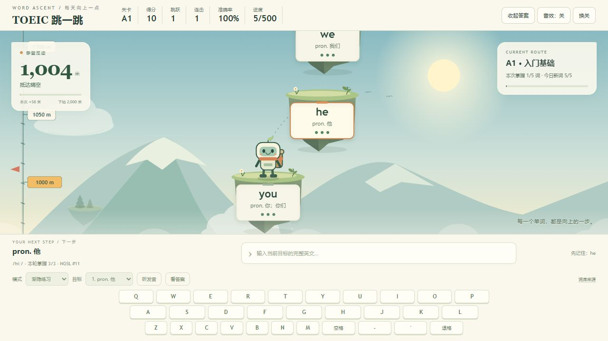
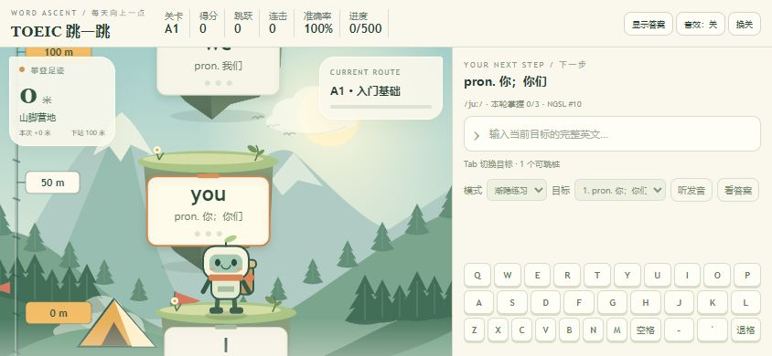
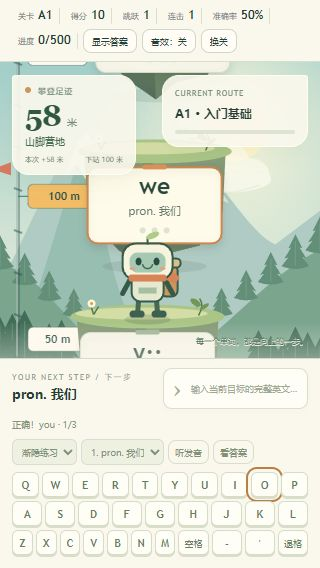
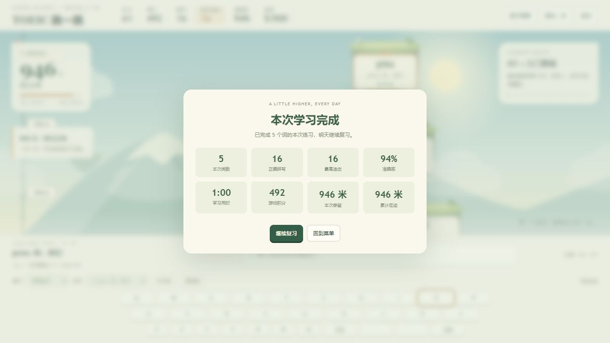

# 独立质检与修复

后续无限模式和输入反馈版本的最新记录见 [ENDLESS_QA.md](ENDLESS_QA.md)。

日期：2026-10-19。检查对象为当前源码与重新生成的 `托业英语跳一跳.html`。

## 结论

发现的问题已修复。21组自动检查通过；实际浏览器完成首轮五词三次掌握、错误重试、退格、混合键盘、回忆/答案提示、结算、刷新续存和跨轮攀登。七种尺寸的键盘全部在视口内，未发现横向溢出。

## 发现与修复

| 问题 | 证据与修复 |
|---|---|
| 复习日期越练越远 | 原来已掌握词每多跳一次就算一次间隔复习；测试复现同一天从1天拉长到30天。现在提前练习不改变到期时间，仅到期复习增长间隔 |
| 首日旧存档误计复习 | 当引入日与最后练习日一致，可确定尚未发生跨日复习；加载时归正这类记录，保留掌握次数与攀登高度。无法确定的跨日历史不擅自重写 |
| 清空后旧高度仍显示 | 自动测试使用隔离内存存档复现，修复运行态、镜头、机器人、统计和高度面板同步归零。真实用户存档没有执行清除 |
| 掉帧时学习用时偏少 | 原来把受限的动画步长作为学习时长。现在学习用时按实际经过时间累计，动画仍保留安全步长 |
| 长词渐隐提示溢出 | 原来每个隐藏字母产生3个字符；改为一个圆点，并为 Canvas 英文设置最大绘制宽度。长词输入自动滚到最新字母 |
| 提示/错误状态不清楚 | 显示/收起答案随当前状态更新；未开始时禁用无目标操作，错误文案使用已有错误色 |
| 已完成词仍被优先选中 | 自动焦点优先未完成词，手动选择仍受尊重 |
| 保存失败不够显眼 | 增加游戏内持续保存失败通知，保存恢复正常后自动消失 |
| 小屏和矮窗口操作不可见 | 320×568修复前键盘底部607px、屏幕仅568px；844×390修复前键盘底部624px。修复后分别为555px、378px。菜单内容滚动，开始/复习按钮固定可见；横屏采用左右分栏 |

## 自动检查

- `node tools/test.js`：21组通过，包括原有11组，及本轮复习时机、旧首日记录修复、清空/取消清空、计时、长词、提示按钮、目标优先级和保存失败恢复检查。
- 新测试先复现原缺陷，再修改实现；未删除原有检查。
- JavaScript语法及离线脚本一致性检查通过。交付文件内含4段脚本，不需要外部 script src。

## 实际浏览器流程

浏览器通过独立地址 `http://127.0.0.1:8770/托业英语跳一跳.html` 读取相同交付文件。与用户本地 file 页面学习存储隔离，未清除或操作真实进度。

1. 从0米开始，故意输错一次，确认显示答案、错误色和准确率变化。
2. 实体键盘输入 `yo`，屏幕退格回到 `y`，点击屏幕 `O` 再用实体键盘输入 `u`，成功落地。
3. 连续拼写，16次正确、1次错误后五词全部达到3/3，结算946米、准确率94%。
4. 刷新：仍为946米、5/500。
5. 进入复习，切换看义回忆、显示和收起答案，再次正确拼写后从946米上升到1004米，触发1000米里程碑。
6. 检查游戏控制台：未发现错误或警告。

## 响应式结果

| 视口 | 页面高 | 键盘底部 | 横向溢出 |
|---|---:|---:|---|
| 320×568 | 568 | 555 | 无 |
| 375×667 | 667 | 654 | 无 |
| 390×844 | 844 | 828 | 无 |
| 768×700 | 700 | 686 | 无 |
| 820×768 | 768 | 749 | 无 |
| 1024×600 | 600 | 586 | 无 |
| 844×390 | 390 | 378 | 无 |

菜单另在320×568、375×667、820×768、1024×600、844×390测量，开始按钮均完整位于可视区域，内容无横向滚动。

原始边界见 [recheck-layouts.json](recheck-layouts.json)、[recheck-menus.json](recheck-menus.json)。

## 截图

## 验证边界

- 浏览器工具没有连接到用户当前的 file 标签页，因此没有直接操作该页面；验收通过本地HTTP读取同一个离线交付文件。导出另做4段内嵌脚本及源码一致性校验。
- 保存失败和清空/取消清空在隔离自动测试中验证，不主动制造用户浏览器存储故障，不清除真实数据。
- 长词宽度由绘制边界测试覆盖；手机尺寸为浏览器模拟，不是实体手机测试。系统语音质量未人工听音检查。
- 首次浏览器权限审核超时，按工具提示原样重试一次后成功，没有绕过权限检查。
